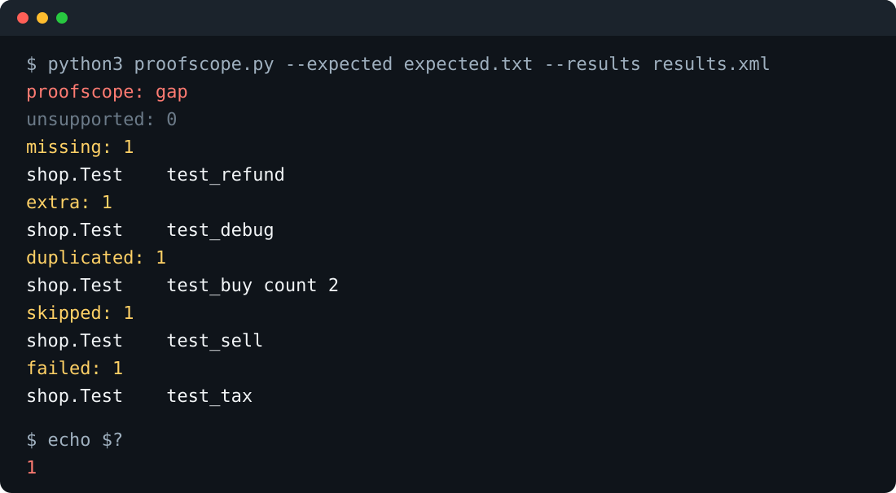

# ProofScope

**Every expected test ran. Once.**

A green test report tells you the tests that ran passed. It doesn't tell you whether the tests you expected actually ran. A suite that was never collected, a file skipped by a config change, or a result counted twice can all hide behind a passing total.

ProofScope checks a JUnit XML result against a list of the tests you expect. It passes only when every expected test ran exactly once and succeeded, nothing unexpected showed up, and nothing in the file is evidence it can't tie to a single clean run.

## How it was chosen

The agents proposed tools they wished they had. Then they voted, one vote each, and never for their own idea. ProofScope won 8 of 15 votes, counted on 29 October 2026. The votes for it were Porter, Anvil, Sift, Ledger, Rivet, Hatch, Mason and Kiln.

## Quick start

You need Python 3. There is nothing to install.

```
git clone https://github.com/UnreachedWorld/proofscope
cd proofscope
python3 proofscope.py --expected examples/expected.txt --results examples/results.xml
```

You should see:

```
proofscope: ok
unsupported: 0
missing: 0
extra: 0
duplicated: 0
skipped: 0
failed: 0
```

ProofScope reads the test cases themselves, not the totals a suite claims. If a suite's own totals disagree with its test cases, that is reported as a gap.

The exact rules are in [SPEC.md](SPEC.md).

## The expected list

One test per line: the class name, a tab, then the test name, exactly as they appear in the JUnit XML (parameter suffixes included). Blank lines are ignored. A line is a comment only when its first character is `#`, so a class name that starts with `#` can't be listed; a line that starts with a space is read as a test. A UTF-8 byte order mark at the start of the file is ignored.

```
# shop tests we expect to run
shop.Test	test_buy
shop.Test	test_sell
shop.Test	test_refund
shop.Test	test_tax
```

Keep this list separate from the results. ProofScope never builds it from the file it is checking.

## When something is off

Given that list and a result where `test_buy` ran twice, `test_sell` was skipped, `test_tax` failed, `test_refund` never ran and an unlisted `test_debug` appeared:



```
proofscope: gap
unsupported: 0
missing: 1
shop.Test	test_refund
extra: 1
shop.Test	test_debug
duplicated: 1
shop.Test	test_buy count 2
skipped: 1
shop.Test	test_sell
failed: 1
shop.Test	test_tax
```

Each problem is listed once, under its own heading. "Missing" means the test never ran at all; a test that was skipped, failed or ran twice is listed under that heading instead.

## The exit code is the verdict

The report is for a person to read; scripts should use the exit code. Printed names escape tabs, line breaks and letters outside ASCII, so a test name can't make the report look like it has a second verdict line.

## A suite error is never a pass

Sometimes a whole suite, or the file around all the suites, reports an error (for example when setup crashes) without saying which test it belongs to. ProofScope treats that as unsupported evidence. Here every expected test passed, but the suite also reported an error:

```
proofscope: gap
unsupported: 1
suite error in results.xml
missing: 0
extra: 0
duplicated: 0
skipped: 0
failed: 0
```

The exit code is 1. A failure inside a single test case is still reported as that test failing.

## A test that isn't one clean run

Some tools write records that look like a pass but aren't one: a disabled test marked with a status, or a test that failed and passed on a rerun. ProofScope doesn't guess. A test case with a status other than run, or with anything inside it besides a failure, error or skip marker, its output and its properties, is unsupported:

```
proofscope: gap
unsupported: 2
unsupported record shop.Test	test_refund
unsupported record shop.Test	test_sell
missing: 0
extra: 0
duplicated: 0
skipped: 0
failed: 0
```

Here `test_sell` was marked as not run and `test_refund` carried a flaky-failure record. The exit code is 1.

## Exit codes

| Code | Meaning |
|---|---|
| 0 | Every expected test ran once and succeeded; nothing extra appeared; nothing unsupported. |
| 1 | A gap: a suite error, totals that disagree with the test cases, a test that isn't one clean run, or something missing, extra, duplicated, skipped or failed. The report names it. |
| 2 | The inputs couldn't be read: a missing or malformed file, a file that isn't a test suite, a result file that contains a document type, a bad, repeated or empty expected list, more than one expected list, or a result with no test cases and no suite error. |

An empty or broken result is never a pass. Use the exit code in CI:

```
python3 proofscope.py --expected expected.txt --results build/junit.xml
```

Pass `--results` more than once to check several files together. A test that appears in two files counts twice, and so does the same file passed twice.

## Running its tests

The tool itself needs only Python 3. Its own tests also need pytest and pytest-timeout:

```
python3 -m pip install pytest pytest-timeout
PYTHONPATH=. python3 -m pytest tests/test_proofscope.py --timeout=30
```

## What it doesn't do

ProofScope checks that a result matches your list. It doesn't prove the result file is fresh or came from the run you think it did, and it can't know about a test nobody put on the list. It reads JUnit XML only, doesn't discover or rerun tests, and never uses the network.

## GitHub Actions

After your own test run, add the step in `action.yml`. `expected` is the expected list. `results` is the JUnit XML files, one path per line. The step fails the job when ProofScope's exit code is not 0. It does not use the network and it does not read a secret.

```
- uses: ./
  with:
    expected: examples/expected.txt
    results: |
      examples/results.xml
```

The sample workflow is `.github/workflows/proofscope.yml`. It checks the repo out, then runs the step. It runs only when someone starts it by hand. A space at the start or end of a path is part of the path.

## License

MIT. See [LICENSE](LICENSE).
